  
  
  

## Selected Builds

<table>
<tr>
<td width="50%" valign="top"><h3>ClassNow</h3>
ANDROID / PRODUCTIVITY

A timetable app with current-class detection and a live home-screen widget.

Kotlin | Jetpack Glance | Android SDK
</td>
<td width="50%" valign="top"><h3>STIGMABOY</h3>
FULL STACK / COMMERCE

Creator marketplace for courses and templates, with authentication, dashboards and order management.

Next.js | TypeScript | Supabase

<a href="https://stigmaboy.vercel.app">Explore project</a>
</td>
</tr>
<tr>
<td width="50%" valign="top"><h3>Portfolio</h3>
WEB / PERSONAL BRAND

Responsive portfolio with animated project showcases and a contact form.

React | Vite | Tailwind CSS | Framer Motion

<a href="https://teju9793.vercel.app">Visit website</a>
</td>
<td width="50%" valign="top"><h3>Study Matrix 360</h3>
WEB / EDUCATION

Student platform for organizing study materials and previous-year question papers.

HTML | CSS | JavaScript | PHP | SQL

<a href="https://studymatrix360.web.app">Open platform</a>
</td>
</tr>
<tr>
<td width="50%" valign="top"><h3>Writers Hub</h3>
WEB / COMMUNITY

Writing and reading platform with a marketplace for products and services.

HTML | CSS | JavaScript | PHP | SQL

<a href="https://writershub.infinityfreeapp.com">Open website</a>
</td>
<td width="50%" valign="top"><h3>NEXOVA</h3>
COMMUNITY / CLUB PLATFORM

Website for a student technical club, its activities, events and announcements.

HTML | CSS | JavaScript | PHP | SQL

<a href="https://nexova.infinityfreeapp.com">Visit website</a>
</td>
</tr>
</table>

## Experience

**InAmigos Foundation (IAF)** 
AI Web Development Intern - Jun-Jul 2026

- Built responsive web pages and applications.
- Explored introductory AI concepts in web applications.
- Gained practical exposure to UI design and modern web technologies.

## Beyond the Code

| NEXOVA | Education |
|---|---|
| Founder & Technical Lead | B.E. - CSE (Data Science) |
| Student-led technical club focused on innovation, AI, programming and skill development. | Sri Siddhartha Institute of Technology, Tumkur |
|  | CGPA - 8.6 / 10 |

